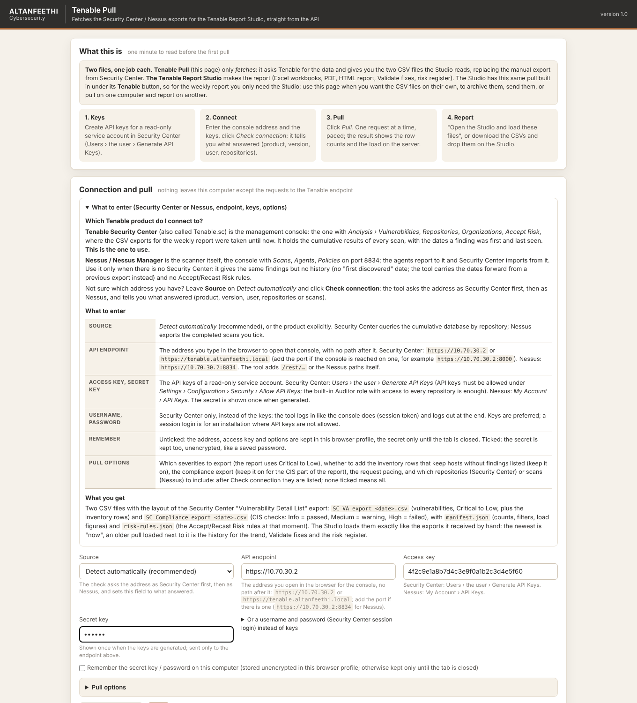
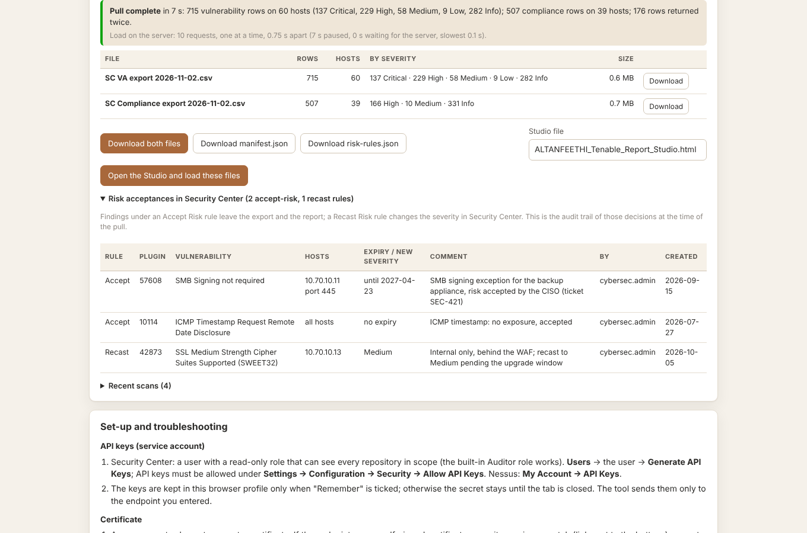
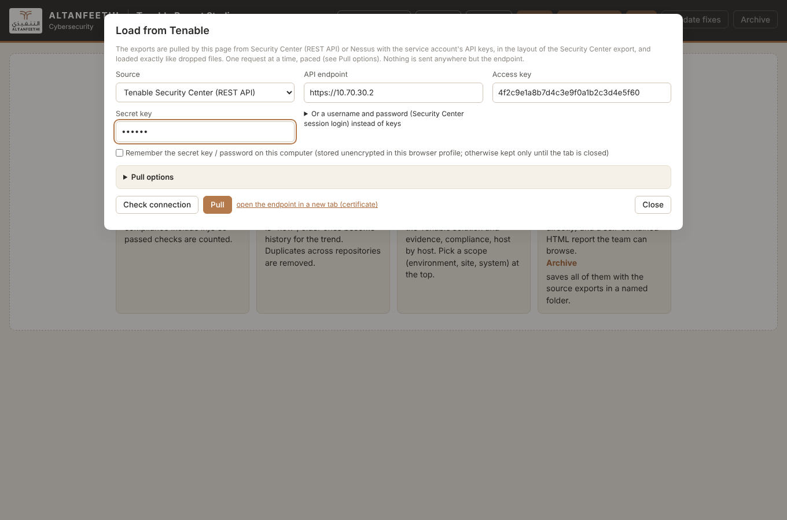

# Tenable Report Studio

Weekly vulnerability-assessment and CIS-compliance reporting for ALTANFEETHI from Tenable Security Center. Nothing to install: HTML files opened in the browser.

## What is what (read this first)

| File | What it does | When you use it |
|---|---|---|
| `studio/ALTANFEETHI_Tenable_Report_Studio.html` | **The report application** (v4.8). Loads the Tenable exports and produces the Excel workbooks (hosts, network), the PDF, the HTML report, Validate fixes and the risk register. Since v4.8 it also **fetches the exports itself**: the **Tenable** button pulls them from Security Center with the service account's API keys and loads them. | Every week. **This is the only file you need.** |
| `studio/Tenable_Pull.html` | **A helper that only fetches.** The same form and the same pull as the Studio's Tenable button, but it stops at the two CSV files: download them, or hand them to the Studio with one click. | Optional: when you want the CSV files on their own (to archive them, send them, or pull on one computer and report on another). |
| `connector/` | The same pull as a **server-side service** for scheduled, unattended runs. | Not needed. Ignore unless you want scheduling later. |

So there are not two applications: one report application, and a small helper that does the first step of it separately.

## Instructions

### 1. Which Tenable product do I connect to?

- **Tenable Security Center** (Tenable.sc) is the management console: the one with *Analysis › Vulnerabilities*, *Repositories*, *Organizations*, *Accept Risk*, where the CSV exports were taken by hand until now. It keeps the cumulative results of every scan with the dates a finding was first and last seen. **Use this one.**
- **Nessus / Nessus Manager** is the scanner itself: the console with *Scans*, *Agents*, *Policies*, on port 8834. The agents report to it and Security Center imports from it. Use it only when there is no Security Center: it gives the same findings but no history (no "first discovered" date; the tool carries dates forward from a previous export instead) and no Accept/Recast Risk rules.
- Not sure which address you have? Leave **Source** on *Detect automatically* and click **Check connection**: the tool asks the address as Security Center first, then as Nessus, and tells you what answered.

### 2. What to enter

| Field | What to enter | Example |
|---|---|---|
| Source | *Detect automatically* (recommended), or the product explicitly | |
| API endpoint | The address you type in the browser to open that console, with no path after it. Add the port if the console is reached on one. The tool adds `/rest/…` (Security Center) or the Nessus paths itself. | `https://10.70.30.2`, `https://tenable.altanfeethi.local`, `https://10.70.30.2:8000` if served on 8000, `https://10.70.30.2:8834` for Nessus |
| Access key, Secret key | The API keys of a read-only service account. Security Center: *Users › the user › Generate API Keys* (API keys must be allowed under *Settings › Configuration › Security › Allow API Keys*; the built-in Auditor role with access to every repository is enough). Nessus: *My Account › API Keys*. | |
| Username, password | Security Center only, instead of the keys: a session login like the console's. Keys are preferred. | |
| Remember | Unticked: address, access key and options are kept in this browser profile, the secret only until the tab is closed. Ticked: the secret is kept too, unencrypted. | |
| Pull options | Severities (the report uses Critical to Low), inventory rows (keep on), compliance export (keep on), request pacing, and the repositories or scans to include (listed after Check connection; none ticked = all). | |

### 3. First run

1. **Check connection.** The result line names the product, version, user and repositories (or the completed scans). If it says the browser could not get an answer, read section 4.
2. **Pull.** One request at a time, paced; the progress shows the rows fetched and, at the end, the row counts per file and the load on the server (requests, time paused, time the server spent).
3. **Load into the Studio.** From the Studio's Tenable button the files load directly. From `Tenable_Pull.html`, "Open the Studio and load these files" (the Studio must sit next to it, or give its path), or download the two CSVs and drop them on the Studio.
4. Build the report as before. Loading an earlier pull's CSVs next to today's gives the trend, Validate fixes and the register closures.

### 4. If Check connection says the browser could not get an answer

Three causes look the same from a page, and the message lists them: the certificate is not trusted (open the endpoint in a new tab and accept it), the host or port is not reachable, or the server does not allow a web page to read its answers (CORS). Security Center and Nessus do not allow it by default. The options, with exact steps in `docs/TENABLE_PULL.md` section 3: serve the two HTML files from the Security Center web root (same origin, nothing to allow), add the CORS headers to the Security Center Apache configuration, or use a dedicated browser profile for this tool only.

### 5. What you get

Two CSV files with the layout of the Security Center "Vulnerability Detail List" export: `SC VA export <date>.csv` (vulnerabilities Critical to Low, plus the inventory rows that keep hosts without findings listed) and `SC Compliance export <date>.csv` (CIS checks: Info = passed, Medium = warning, High = failed), with `manifest.json` (counts, filters, load figures) and `risk-rules.json` (the Accept/Recast Risk rules at that moment).

### 6. Not breaking Security Center

Every analysis page is a database query, so the pull sends one request at a time, waits between requests (Gentle 2 s, Normal 0.75 s, Fast 0.15 s), uses moderate pages (1,000 / 500 rows), times a request out after 2 minutes and backs off on 429 / 503, honouring Retry-After. A pull of the current estate is roughly 75 requests. Run it outside the scan windows.

| Tenable Pull | After the pull | The Studio's Tenable button |
|---|---|---|
|  |  |  |

## Repository layout

| Path | What |
|---|---|
| `studio/ALTANFEETHI_Tenable_Report_Studio.html` | the Studio v4.8 (built: the v4.7 fixes plus the Tenable panel) |
| `studio/Tenable_Pull.html` | the fetch helper (built) |
| `studio/src/` | the engine (`tenable_pull.js`), the helper's page template, the Studio panel glue, the engine's unit tests |
| `tools/build_tenable.py` | builds both HTML files from `studio/src/`; `--check` verifies them |
| `tools/patch_studio.py` | the v4.7 fixes to the Studio as exact, verifiable patches |
| `docs/TENABLE_PULL.md` | the full guide: set-up, where to run the file, pacing, troubleshooting |
| `docs/REVIEW.md` | the application review of v4.6: architecture, strengths, findings, recommendations |
| `docs/ARCHITECTURE.md` | how the pull works and how it hooks into the Studio |
| `docs/ROADMAP.md` | what comes next |
| `docs/PROJECT_NOTES.md` | the running notes delivered with the Studio (history, decisions, QA) |
| `connector/` | optional server-side service, with its own README, `DEPLOYMENT.md` and tests |

## Tests

```bash
node --test studio/src/tenable_pull.test.mjs             # the engine: CSV, dates, ids, pacing and retries with a fake fetch
cd connector && pip install -e .[test] && pytest        # 25 tests, including the browser runs
```

The browser tests open `Tenable_Pull.html` from a folder in Chromium against a synthetic Security Center that allows the page (CORS) and refuses every 7th analysis request with HTTP 429: the pull completes with the figures an independent recount predicts, the files are handed over to the Studio, the Studio's own Tenable button pulls and loads, and a server that does not allow the page produces the explanatory message.

## Changing the tool

Edit `studio/src/tenable_pull.js` (engine and shared panel), `studio/src/Tenable_Pull.template.html` (the helper page) or `studio/src/studio_panel.js` (the Studio button), then `python3 tools/build_tenable.py`. The Studio keeps its own code untouched apart from the v4.7 fixes; the panel is an inline block before `</body>` that the build replaces.
