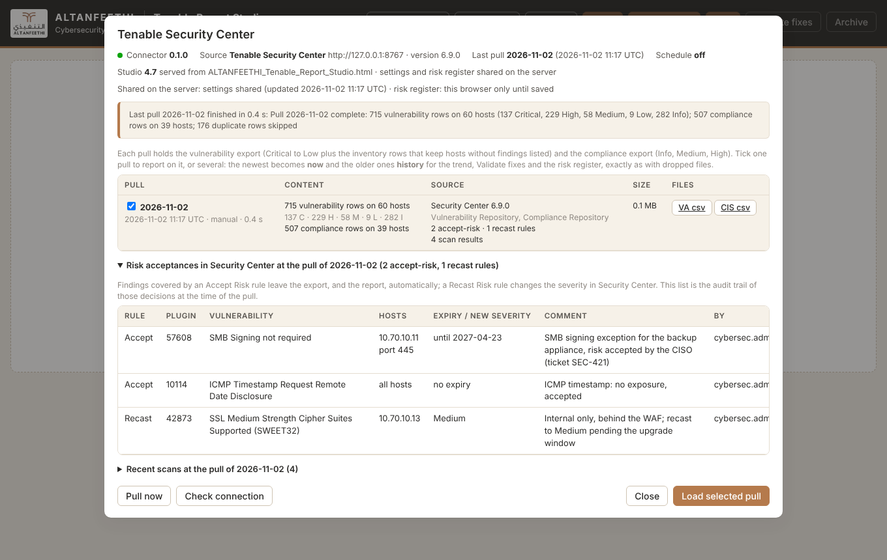
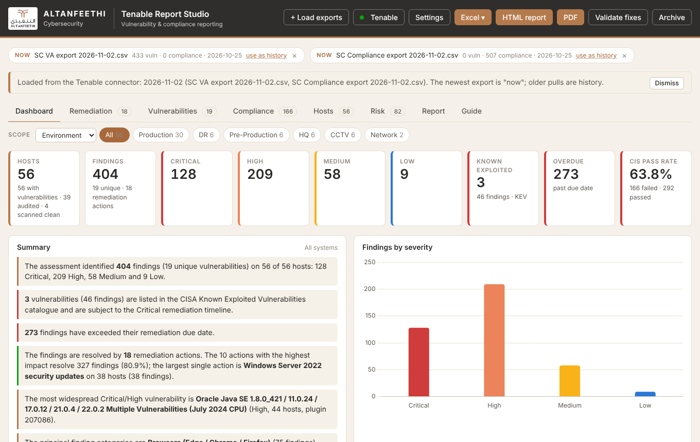
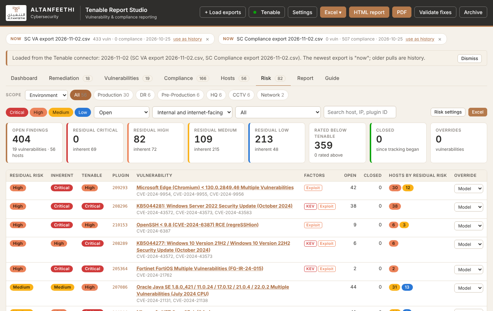

# Tenable Report Studio

Weekly vulnerability-assessment and CIS-compliance reporting for ALTANFEETHI from Tenable Security Center.

- **The Studio** (`studio/ALTANFEETHI_Tenable_Report_Studio.html`, v4.7): a single-file browser tool that turns Security Center exports into the Excel workbooks (hosts, network), the PDF and the self-contained HTML report, validates fixes between two exports and keeps a residual-risk register. Runs from a folder, nothing leaves the browser.
- **The connector** (`connector/`, new): a small Python service for the Tenable VM. It pulls the same data from Security Center (REST API) or Nessus (port 8834) on a weekly schedule or on demand, keeps every pull as Studio-ready export files with the Accept/Recast Risk rules and the scan results of that moment, and serves the Studio on port 8000 with a **Tenable** panel that loads a pull straight into it. Report settings and the risk register are kept on the server, shared by the team.

```
workstation ──:8000──▶ connector (Tenable VM) ──:443──▶ Security Center
   browser            Studio + Tenable panel   ──:8834─▶ Nessus / Nessus Manager (optional source)
```

## Repository layout

| Path | What |
|---|---|
| `studio/` | the Studio and its `CHANGELOG.md` |
| `connector/` | the service (`trs_connector` package), its tests and deployment files |
| `tools/patch_studio.py` | the v4.7 changes to the Studio as exact, verifiable patches |
| `docs/REVIEW.md` | the application review of v4.6: architecture, strengths, findings, recommendations |
| `docs/ARCHITECTURE.md` | how the connector works and how it hooks into the Studio |
| `docs/DEPLOYMENT.md` | installing on the VM: API keys, config, systemd, firewall, TLS, first run |
| `docs/ROADMAP.md` | what comes next |
| `docs/PROJECT_NOTES.md` | the running notes delivered with the Studio (history, decisions, QA) |

## Screenshots (demo data)

| The Tenable panel | The Studio after loading a pull | The Risk tab |
|---|---|---|
|  |  |  |

## Try it in five minutes, without Tenable

```bash
cd connector
python3 -m venv .venv && . .venv/bin/activate
pip install -e .
trs-connector demo
```

Open <http://127.0.0.1:8000/>, click **Tenable**, **Pull now**, then **Load selected pull**. The demo runs a synthetic Security Center (60 hosts following the ALTANFEETHI segmentation rules) next to the connector.

## Against your Security Center

```bash
trs-connector init-config /etc/trs-connector/config.yaml    # edit: sc.url and the API keys, server.auth
trs-connector --config /etc/trs-connector/config.yaml probe  # connection, repositories, field mapping, row counts
trs-connector --config /etc/trs-connector/config.yaml pull   # one pull, written to the store
trs-connector --config /etc/trs-connector/config.yaml serve  # the Studio on :8000 and the weekly schedule
```

`docs/DEPLOYMENT.md` has the complete procedure, including the systemd unit in `connector/deploy/`.

## Tests

```bash
cd connector && pip install -e .[test] && pytest
```

19 tests: the Security Center client and the pull against a mock Security Center (paging, filters, an older version rejecting a filter, bad keys), the export column fidelity with the Studio's own alias table, the Nessus source (`.nessus` parsing, first-seen carried forward between pulls), the HTTP service (authentication, downloads, shared state), and an end-to-end run in Chromium: the Studio served by the connector loads a pull through the panel and shows exactly the figures an independent recount of the synthetic data predicts.
