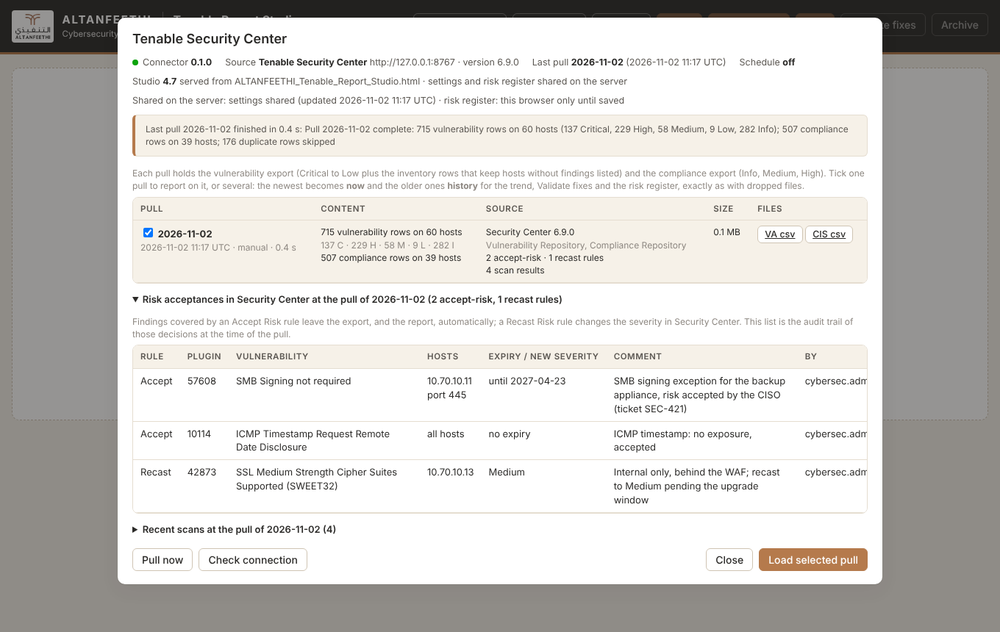
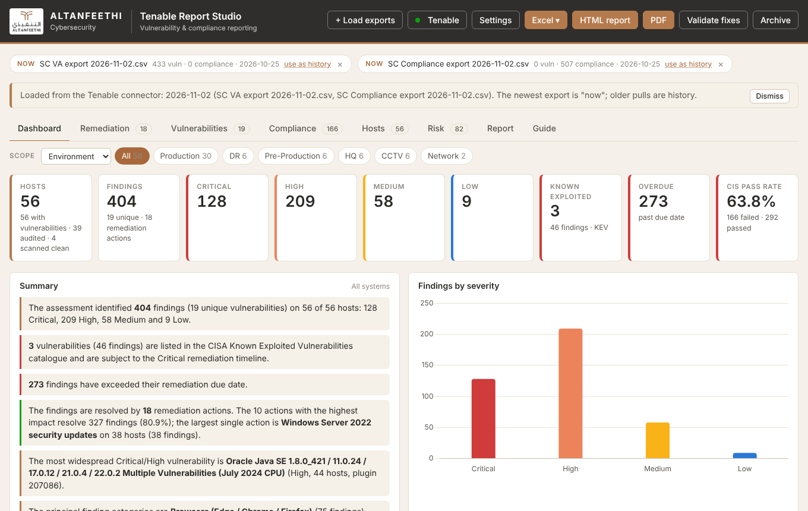
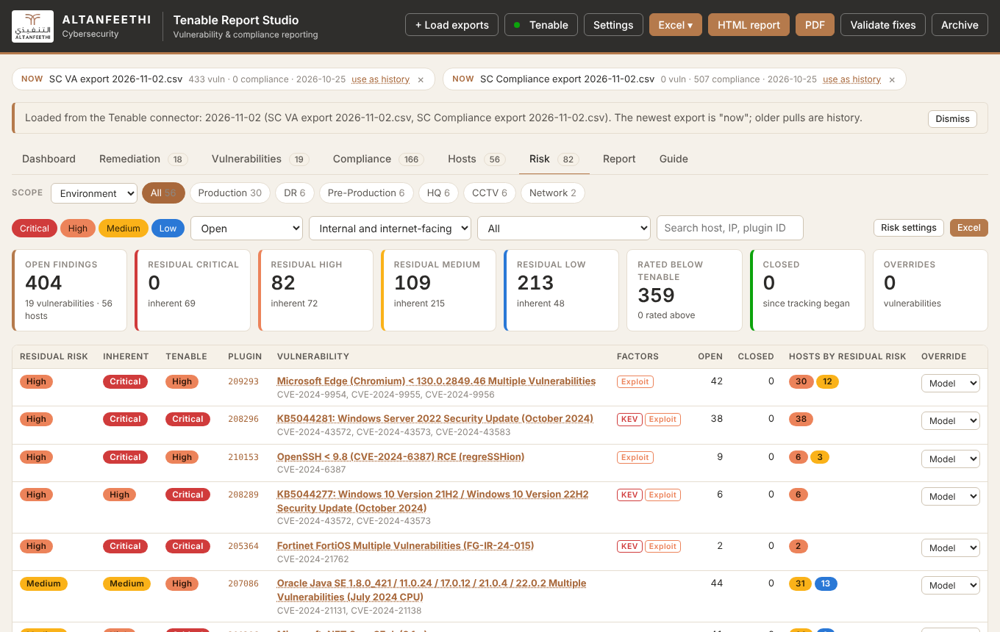

# trs-connector

The service that pulls Tenable Security Center (or Nessus) results on a schedule, keeps them as Studio-ready exports and serves the Tenable Report Studio with a Tenable panel.

```bash
pip install -e .            # or: pip install .
trs-connector demo          # synthetic Security Center + the Studio on http://127.0.0.1:8000
trs-connector init-config   # writes config.yaml
trs-connector probe         # connection and field mapping against the real Security Center
trs-connector pull          # one pull now
trs-connector serve         # the Studio, the API and the weekly schedule
trs-connector list          # the pulls in the store
```

Optional: the lightweight tool (`../studio/Tenable_Pull.html`) and the Studio's Tenable button do the same pull from the browser with nothing to install; this service is for scheduled, unattended pulls.

The client sends one request at a time, `sc.request_interval` seconds apart (0.75 by default), with retries and exponential backoff on 429 / 502 / 503 / 504 (Retry-After honoured); page sizes default to 1,000 vulnerability rows and 500 compliance rows.

Documentation: `DEPLOYMENT.md` (install on the VM), `../docs/ARCHITECTURE.md` section 2. Tests: `pip install -e .[test] && pytest`.

| The connector panel in the Studio | The Studio after loading a pull | The Risk tab |
|---|---|---|
|  |  |  |
